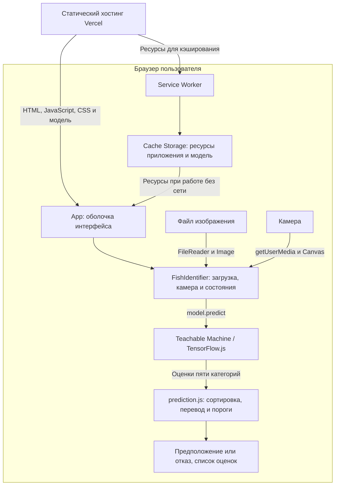

# FishIdentifier

Веб-приложение для распознавания рыб по фотографии. Пользователь загружает изображение или делает снимок камерой, а нейросетевая модель предлагает категорию рыбы и показывает оценки всех вариантов.

Распознавание выполняется в браузере через Teachable Machine и TensorFlow.js. Фотография не отправляется на сервер распознавания. После загрузки и кэширования ресурсов приложение может работать без интернета.

**Работающее приложение:** [fish-identifier-phi.vercel.app](https://fish-identifier-phi.vercel.app).

## Возможности

- Загрузка изображения через диалог выбора файла или перетаскивание.
- Съёмка камерой с предварительным просмотром и отменой.
- Распознавание четырёх категорий рыб: сом, гурами, окунь и щука.
- Вывод предполагаемой категории и оценок всех выходов модели.
- Отказ от уверенного определения при неизвестном объекте или слабом ответе модели.
- Повторный анализ, сброс изображения и восстановление после ошибки загрузки модели.
- Адаптивный интерфейс, манифест PWA и работа без сети после кэширования.

Размер загружаемого файла ограничен 20 МиБ. Поддержка конкретного формата изображения зависит от браузера.

## Технологии

| Задача | Средства |
| --- | --- |
| Интерфейс | React 18, JavaScript, CSS |
| Загрузка модели и распознавание | `@teachablemachine/image`, TensorFlow.js |
| Работа с изображениями и камерой | FileReader, Image, Canvas, MediaDevices API |
| Работа без сети | Service Worker, Cache Storage |
| Сборка | Create React App, `react-scripts` 5 |
| Модульные и компонентные тесты | Jest, React Testing Library |
| Браузерные проверки | Playwright, Chromium |
| Публикация | Vercel, статическая сборка |

## Архитектура

Приложение состоит из клиентского интерфейса, модуля интерпретации результатов и файлов нейросетевой модели. Хостинг раздаёт статические ресурсы. Отдельного API распознавания, базы данных и регистрации пользователей нет.



### Основные модули

| Файл | Назначение |
| --- | --- |
| [`src/App.js`](src/App.js) | Оболочка страницы, заголовок, подвал и определение standalone-режима. |
| [`src/components/FishIdentifier.js`](src/components/FishIdentifier.js) | Загрузка модели, выбор файла, работа с камерой, запуск анализа и отображение результата. |
| [`src/prediction.js`](src/prediction.js) | Нормализация меток, перевод названий, сортировка оценок и решение об отказе. |
| [`public/model/`](public/model/) | Структура сети, метаданные и веса модели. |
| [`public/service-worker.js`](public/service-worker.js) | Обработка запросов, кэширование ресурсов и удаление устаревших кэшей приложения. |
| [`public/manifest.json`](public/manifest.json) | Название, иконки, область действия и параметры запуска PWA. |
| [`scripts/build-service-worker.cjs`](scripts/build-service-worker.cjs) | Формирование списка ресурсов и версии кэша после сборки. |

### Путь обработки изображения

1. При открытии страницы загружаются модель и её метаданные. До завершения загрузки распознавание недоступно.
2. Пользователь выбирает файл или делает снимок. Для файла проверяются MIME-тип и размер; кадр камеры переносится на Canvas.
3. Изображение декодируется и передаётся в `model.predict`. Библиотека подготавливает его к входу модели размером 224 x 224 пикселя.
4. `summarizePredictions` сортирует оценки, переводит название категории и проверяет условия отказа.
5. Интерфейс показывает предположение либо сообщение о невозможности уверенного определения. Оценки всех категорий доступны в раскрывающемся блоке.

Состояния хранятся в React-компоненте. Ссылки на модель, видеопоток и текущие запросы сохраняются через `useRef`. Номера запросов защищают интерфейс от запоздалых ответов. После съёмки, отмены или размонтирования компонента треки камеры останавливаются.

## Модель и интерпретация результата

Модель подготовлена в Teachable Machine и сохранена в формате TensorFlow.js:

- [`model.json`](public/model/model.json) описывает структуру сети и размещение весов.
- [`metadata.json`](public/model/metadata.json) содержит размер входа и названия категорий.
- [`weights.bin`](public/model/weights.bin) содержит веса сети.

| Метка модели | Название в интерфейсе |
| --- | --- |
| `Catfish` | сом |
| `Gourami` | гурами |
| `Perch` | окунь |
| `northern pike` | щука |
| `unknown` | неизвестный объект |

Приложение отказывается от уверенного ответа, если выполнено хотя бы одно условие:

- Наибольшую оценку получила категория `unknown`.
- Максимальная оценка меньше 80%.
- Разница между двумя наибольшими оценками меньше 15 процентных пунктов.

Эти правила заданы в [`src/prediction.js`](src/prediction.js). Пороги являются эвристиками и не калиброваны на отдельной контрольной выборке. Оценка модели показывает предпочтение среди заданных категорий и не является подтверждённой вероятностью правильного определения.

Названия «сом», «гурами» и «окунь» обозначают группы рыб. Экспорт модели не описывает состав обучающей выборки, поэтому поддержка всех видов внутри этих групп не подтверждена. Скриптов обучения в репозитории нет.

## Локальный запуск

Нужны Git, Node.js 24 и npm. Версия Node.js указана в [`.nvmrc`](.nvmrc). Команды ниже подходят для Linux и WSL; `nvm use` требует установленного nvm.

```bash
git clone https://github.com/niory/FishIdentifier.git
cd FishIdentifier
nvm install
nvm use
npm ci
npm start
```

Откройте [localhost:3000](http://localhost:3000). Если Node.js 24 уже установлен, команды `nvm install` и `nvm use` можно пропустить.

Для камеры нужны разрешение браузера и безопасный контекст: HTTPS либо localhost. При открытии сайта на телефоне по обычному HTTP-адресу компьютера камера может быть недоступна; загрузка изображения остаётся доступной.

## Сборка и предпросмотр

```bash
npm run build
npm run preview
```

Готовые файлы находятся в `build/`. Предпросмотр доступен по адресу [127.0.0.1:4173](http://127.0.0.1:4173). Порт 4173 должен быть свободен.

Команда `npm run build` автоматически запускает `postbuild`: скрипт просматривает готовую сборку, вычисляет версию кэша по содержимому ресурсов и записывает список файлов в `build/service-worker.js`. Для публикации нужно использовать весь каталог `build/`.

## Проверки

### Модульные и компонентные тесты

```bash
CI=true npm test -- --watchAll=false --runInBand
```

Проверяются переводы категорий, обработка оценок, условия отказа, повторная загрузка модели, ошибки камеры, отмена запроса, остановка видеопотока и ограничение размера файла.

### Браузерные тесты

Установите Chromium для Playwright:

```bash
npx playwright install chromium
npm run test:e2e
```

В минимальном Linux для установки браузера вместе с системными библиотеками используйте `npx playwright install --with-deps chromium`.

`test:e2e` самостоятельно собирает приложение и запускает временный сервер на порту 4173. Сценарии проверяют загрузку и повторный выбор фотографии, повреждённый файл, восстановление после ошибки модели, съёмку и отмену, мобильную компоновку и офлайн-распознавание в корне сайта и подпапке. Для офлайн-проверок обычный HTTP-кэш отключается.

Камера в браузерных тестах имитируется. Проверка физической камеры и установки PWA на iOS или Android требует отдельных испытаний.

### Проверка на фотографиях

```bash
npm run build
npm run test:photos
```

Сценарий использует восемь сохранённых фотографий Wikimedia Commons и контрольное изображение без рыбы. Перед запуском установите Chromium командой выше. Сервер запускается самим сценарием, поэтому отдельно запускать `npm run preview` не нужно.

Результаты сохраняются в `reports/photo-evaluation.json`, `reports/photo-evaluation.md`, `reports/photo-evaluation.html` и `reports/photo-evaluation.png`. Отчёт содержит предсказания, оценки и отказы; сценарий не устанавливает минимально допустимую точность.

В сохранённом [отчёте](reports/photo-evaluation.md) категория распознана правильно на семи из восьми фотографий рыб. Для жемчужного гурами модель предложила щуку с оценкой 76,29%, и интерфейс отклонил ответ. Это результат небольшой подборки, а не оценка общей точности модели.

Авторы фотографий, лицензии, ссылки и контрольные суммы находятся в [`tests/photos/sources.json`](tests/photos/sources.json). Повторно скачать подборку можно с помощью Python 3:

```bash
python3 scripts/download-photos.py
```

## Работа без сети

Service Worker сохраняет HTML, JavaScript, CSS, иконки и файлы модели, включая веса. Для автономного запуска нужно сначала открыть приложение с интернетом и дождаться успешной установки Service Worker и кэширования ресурсов.

Первое посещение без сети не поддерживается. В режиме разработки Service Worker не регистрируется. При обновлении новая версия ожидает закрытия вкладок, использующих прежнюю. Удаляются только устаревшие кэши этого приложения в его области действия.

Фотографии и история распознаваний не сохраняются в постоянное хранилище приложения. Перезагрузка страницы начинает новый сеанс.

## Публикация на Vercel

Параметры размещения заданы в [`vercel.json`](vercel.json):

| Настройка | Значение |
| --- | --- |
| Framework | Create React App |
| Install Command | `npm ci` |
| Build Command | `npm run build` |
| Output Directory | `build` |

Для нового размещения импортируйте репозиторий в Vercel и используйте эти настройки. В существующем проекте, подключённом к ветке `main`, отправка изменений запускает новую публикацию.

Относительные пути ресурсов позволяют размещать сборку в корне сайта или подпапке. Статическому хостингу нужно отдавать файлы модели и сгенерированный Service Worker вместе с остальной сборкой.

## Структура репозитория

```text
FishIdentifier/
├── public/
│   ├── model/                  # Структура, метаданные и веса модели
│   ├── index.html              # HTML и регистрация Service Worker
│   ├── manifest.json           # Манифест PWA
│   └── service-worker.js       # Обработка запросов и кэширование
├── src/
│   ├── components/             # Интерфейс распознавания и его стили
│   ├── App.js                  # Оболочка приложения
│   ├── App.test.js             # Компонентные проверки
│   ├── prediction.js           # Интерпретация оценок модели
│   └── prediction.test.js      # Проверки правил распознавания
├── scripts/                    # Сборка кэша, сервер и проверка фотографий
├── tests/
│   ├── photos/                 # Проверочные изображения и их источники
│   └── app.spec.js             # Браузерные сценарии
├── reports/                    # Сохранённые результаты проверки фотографий
├── playwright.config.js        # Настройки браузерных тестов
├── package.json                # Зависимости и команды проекта
└── vercel.json                 # Настройки публикации
```
